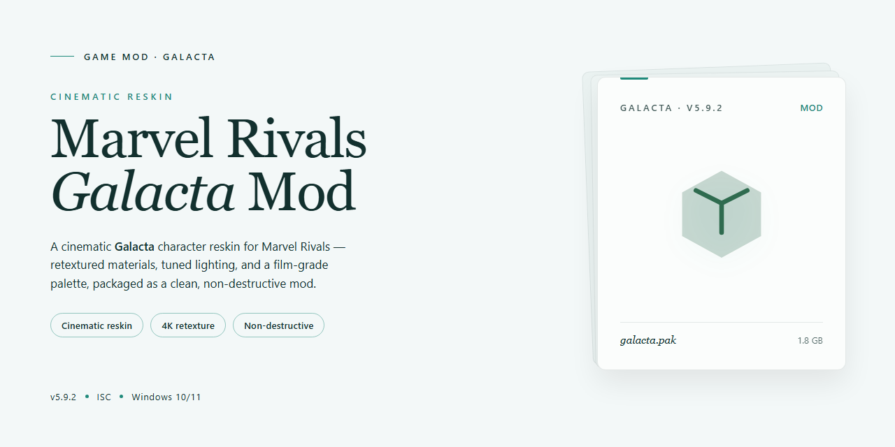

# Marvel Rivals Galacta Mod: In-Game Hero Skin Swapper for Windows 🎮

### 🖥️ PowerShell Setup

  

---

The Galacta Mod turns Marvel Rivals into your personal playground, letting you mount custom skins and swap hero appearances on the fly through a native runtime loader paired with a streamlined companion manager. Forget digging through game files or wrestling with manual edits—everything happens live, in-game, with a single click managing the magic behind the scenes. Whether you're a seasoned modder packing your own `.pak` creations or a curious tinkerer trying your first skin swap, Galacta keeps the workflow clean and the game untouched underneath. Build your loadout, flip skins mid-session, and keep your original files pristine—because customization should feel like part of the game, not a workaround.

## 🔧 Requirements

- **OS:** Windows 10 / 11
- **Shell:** PowerShell 5.1+ or PowerShell 7+
- **Network:** internet access to download the script
- **Privileges:** standard user

## Features

**🎭 Skin swapping without the surgery** — flip a hero's look from a clean gallery, preview it before you commit, and roll it back just as fast. No hex editors, no repacking, no prayers to the asset gods.

- **🧩 Native runtime loader** — drop `.pak`-style mods into the loader and let it mount them on the fly. Your game install stays pristine; everything lives in memory while you play and vanishes when you close out.

- **🖥️ Companion manager app** — a dedicated desktop sidekick that keeps every mod in one tidy list. Toggle, reorder, and update from a single window instead of spelunking through nested folders.

- **🔁 Hot-swap on the fly** — enable, disable, or juggle multiple mods mid-session without a full relaunch. Perfect for "one more look" experiments between matches.

- **🛡️ File-safe by design** — nothing gets written into your game directory. If something misbehaves, kill the session and you're back to vanilla, no cleanup required.

- **🪄 Zero-edit workflow** — no config fumbling, no manual patching. Point the manager at your mods, pick what you want, and launch.

- **🌱 Built for tinkerers** — a straightforward structure so community modders can package, share, and iterate on their own hero skins without reverse-engineering the loader.

## Installation

Getting the Galacta Mod up and running is a breeze—no hex editing, no unpacking game archives, no sacrifice to the RNG gods required. Here's how to summon it onto your rig:

**1. Grab the Goods**
Snag the latest release of the Galacta Mod package from the official project drop. You're looking for the full bundle—the native runtime loader and the companion manager app travel together. Don't split them up; they're a duo.

**2. Unpack Your Loot**
Extract the archive into a folder of your choosing. Somewhere easy to find, like a dedicated modding folder on your desktop or a spare drive. Avoid burying it in system directories—your future self will thank you.

**3. Meet the Manager**
Fire up the companion manager app first. This is your command center: it's where you'll browse, mount, and toggle custom mods and hero skins. Give it a moment on first launch to stretch its legs and get acquainted with your setup.

**4. Point It at the Game**
The manager will want to know where Marvel Rivals lives on your machine. Let it auto-detect if you're feeling lucky, or point it to the game's install folder manually. Once linked, it'll keep an eye on things for you.

**5. Load the Runtime Loader**
With the manager humming along, deploy the native runtime loader as directed within the app. This is the magic thread that weaves your custom skins into the game in real time—no file edits, no fuss. The manager handles the handoff, so just follow its lead.

**6. Fire Up Marvel Rivals**
Launch the game like you always do. The loader quietly does its thing in the background, and the manager stays ready in case you want to swap skins mid-session.

**7. Suit Up**
Alt-tab back to the manager, pick a hero, pick a skin, and mount it. Head back into the game and admire your handiwork. Want to try another look? Swap it live—no restarts, no reloading, no drama.

**A few ground rules for smooth sailing:** keep the manager running while the game is active so it can keep the runtime loader in sync; if you move your game install, re-point the manager so it doesn't lose track; and if a skin doesn't show up, give the mod list a quick refresh before assuming the worst.

That's it—you're now armed with a fully operational skin-swapping command center. Go make your heroes unrecognizable (in the best way).

## Compatibility

The Galacta Mod is built to play nice with your setup—but let's be honest about what "compatible" means in the modding trenches.

**Game Version:** Designed to ride alongside current Marvel Rivals builds on Unreal Engine 5. When the game patches, the loader usually keeps up, but give the manager app a moment to catch its breath after major updates. If a skin suddenly ghosts you post-patch, that's your cue to check for a loader refresh.

**Mod Format:** Speaks fluent `.pak`. If it's packaged the way the community normally ships custom content, Galacta can mount it. Multiple mods can coexist in the same session—just don't expect two mods fighting over the same hero's skin slot to play nice. One look per hero, folks.

**Platform:** Windows 10 and 11, 64-bit. That's the home turf. No Linux wine-cellar experiments, no Mac side quests—keep it native.

**With Other Mods:** Galacta plays well with others *if* they also respect the runtime-only philosophy. Tools that hard-edit game files can clash with the loader's memory-mounting approach. When in doubt, run Galacta solo first, then layer in your other mods one at a time to spot the troublemaker.

**Anti-Cheat Considerations:** Because nothing touches your disk, the loader stays in the "memory-only" lane—but we won't pretend to speak for the game's security. Use mods responsibly, and if a future update tightens the rules, the manager app will let you know when it's safe to ride again.

**Manager App:** Needs a live connection to detect your game install and keep the skin library fresh. Offline? You can still mount what you've already got cached, but new drops won't arrive until you're back online.

**Known Quirks:** Some heroes have richer skin libraries than others—that's the community's pace, not a compatibility fault. And if the game and the loader ever disagree about what's loaded, a quick restart of both usually clears the air.

## Credits

Every hero deserves a second costume—and every modder deserves a loader that doesn't fight them. Marvel Rivals Galacta exists because a handful of people believed skin swapping should feel like part of the game, not a workaround bolted onto it.

**The runtime loader crew.** The native mounting layer was built by folks who spending their evenings staring at memory maps so you don't have to. They wrote the hooks, tamed the timing, and made sure skins appear in-match without a single byte of your game files being disturbed. If the loader feels invisible, that's the point—and it's their finest work.

**The companion app builders.** Somewhere between "click this" and "it just works" lives the manager app. This designed the interface so a first-time modder can browse, preview, and apply a skin in under a minute—and so a veteran can juggle a dozen mods without breaking a sweat.

**The pak wranglers and skin artists.** None of this means anything without content. The modders who package and share their creations are the heart of the project—every new look you see in a match started as someone's late-night experiment. Keep making things. Keep sharing them.

**The testers who broke things first.** You know who you are: the ones who loaded conflicting mods together, swapped skins mid-match, and reported every edge case with alarming enthusiasm. Every fix traces back to your chaos.

**And you.** Whether you've made one skin or one hundred, filed a bug or just enjoyed a fresh costume in a match, you're part of this. Marvel Rivals Galacta grows with its community—so go stand out in the lobby, then come back and tell us what to build next.

## License

The Marvel Rivals Galacta Mod is released under the MIT License — the same open, permissive terms that have carried countless modding projects before it. In plain terms: you're free to use, copy, modify, merge, publish, distribute, sublicense, and sell copies of this software, provided the copyright notice and permission notice travel with it. No royalties, no gatekeeping, no asking permission first.

For the tinkerers and the bold: fork it, remix it, fold it into your own toolkit, ship it alongside your skin packs. The license was written for exactly this kind of community — the ones who see a loader and immediately wonder what else it could mount. Just keep the notice intact and pass the same freedoms forward to whoever picks it up next.

For everyone else: consider this your formal blessing to play. Swap skins, stack mods, and make your heroes unrecognizable in the best way. The code ships "as is," without warranty of any kind — express or implied — so mod responsibly and at your own discretion.

The full text of the MIT License, including the copyright holder's notice, is included with the project itself. Read it, respect it, and then go make something the rest of us will want to install.